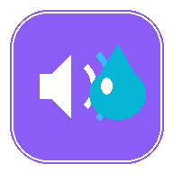
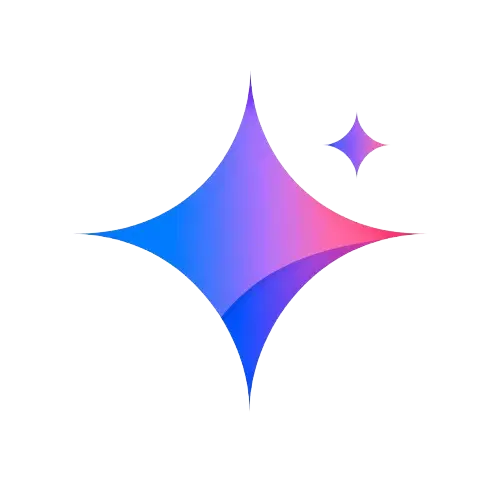

<!-- Header Banner -->

<!-- Dynamic Typing Subtitle -->

  

<!-- Badges Bar -->

  
  
  
  

---

## 💡 About DevDeskApp

**DevDeskApp** builds high-performance, open-source web utilities and progressive web applications engineered with **100% client-side privacy**.

We believe everyday tools should be lightning fast, beautifully designed, and respect user privacy by default — running entirely inside the web browser with **zero server uploads, zero accounts, and zero telemetry**.

---

## 🚀 Featured Production Projects

<table>
  <tr>
    <td width="50%" valign="top">
      

        
         
        <h3>🔊 WaterEjector</h3>
        

          
          
        

      

      

        Free acoustic cleaner and sound recovery utility using scientifically tuned 165Hz sound pulses, frequency sweeps, and haptic vibrations to expel trapped water and dislodge pocket lint from phone speakers.
      

      <ul>
        <li>💦 165Hz Pulsed Water Ejection</li>
        <li>🧹 Acoustic Dust Sweep & Haptic Modes</li>
        <li>🎧 Stereo Balance & Diagnostic Testers</li>
        <li>📱 Progressive Web App (PWA) Offline Ready</li>
      </ul>
    </td>
    <td width="50%" valign="top">
      

        
         
        <h3>✨ Gemini Watermark Remover</h3>
        

          
          
        

      

      

        Lossless in-browser tool to remove transparent watermarks from Gemini Omni videos and Nano Banana AI images using exact mathematical alpha unblending instead of blurry inpainting.
      

      <ul>
        <li>🔬 Exact Alpha Subtraction (Zero Blur)</li>
        <li>🎬 Frame-by-Frame Video Processing (MP4)</li>
        <li>🎵 Preserves High-Definition Audio Tracks</li>
        <li>🎛️ Real-time Visual Tuner & Split Comparison</li>
      </ul>
    </td>
  </tr>
</table>

---

## 🛡️ Core Engineering Pillars

| Principle | How We Build |
| :--- | :--- |
| 🔒 **100% Client-Side Privacy** | All media processing (Web Audio, Canvas API, WebCodecs) executes entirely on your device. Zero bytes uploaded to the cloud. |
| ⚡ **Extreme Performance** | Built with semantic HTML5, modern vanilla CSS, and vanilla ES6+. Zero heavy framework overhead for instant page loads. |
| 📱 **Progressive Web Apps** | Offline-ready with service workers and installable on iOS Safari, Android Chrome, and Desktop platforms. |
| 🆓 **Truly Free & Accessible** | No paywalls, no mandatory signups, and no artificial limitations. |

---

## 🛠️ Tech Stack & Tooling

---

## 🤝 Connect & Support

- 🌐 **Official Website:** [https://www.devdeskapp.com/](https://www.devdeskapp.com/)
- ☕ **Support Our Work:** [https://buymeacoffee.com/devdeskapp](https://buymeacoffee.com/devdeskapp)
- 🐛 **Report Issues:** Submit feedback directly via each tool's GitHub repository issues tab.

 

  &copy; 2026 <strong>DevDeskApp</strong> • Crafted for the open web.

